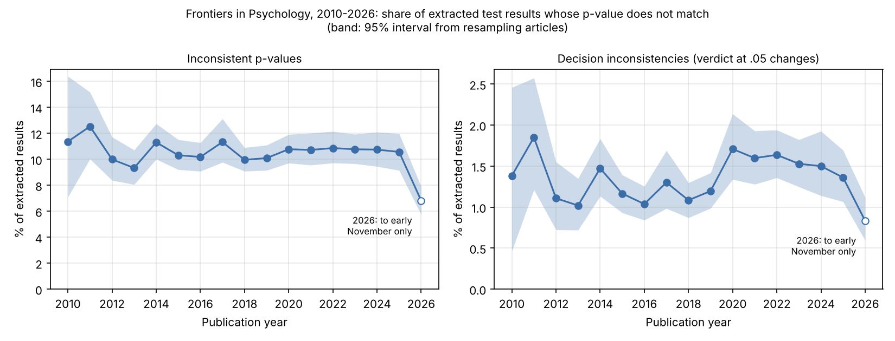

# Trend in statistical reporting inconsistencies in an open-access psychology journal, 2010 to 2026

## Question

Among articles in the open-access journal *Frontiers in Psychology* with
machine-readable full text, what fraction of null-hypothesis test results
reported in the standard form (a t, F, chi-square, r or z statistic with its
degrees of freedom and a p-value) give a p-value that does not match the one
recomputed from the reported statistic and degrees of freedom, for each
publication year from 2010 to 2026? Has that fraction, and the fraction of
mismatches that change the verdict at the 0.05 level, gone up, gone down, or
stayed the same over that period?

An answer is a table by publication year of: articles sampled, articles with
at least one extractable result, results extracted, the share of results that
are inconsistent, the share that are decision-changing, and the share of
articles with at least one of each, with confidence intervals that account for
results clustering within articles; a trend estimate with its uncertainty; and
a hand-checked sample of the automated flags with the false-positive rate.

Scope as run: the feasibility check showed that every article could be
fetched, so the analysis covers all of them and no sampling was needed. No
second journal was added.

## Why it matters

A widely cited 2016 study using the `statcheck` program found that about half
of psychology articles from 1985 to 2013 contained at least one p-value that
did not match its test statistic (Nuijten et al. 2016, read in this session;
see Prior work). Since then the field has gone through a decade of
reform aimed at more careful reporting, some journals run automated checks at
submission, and writing tools have changed. Whether reporting accuracy in the
published record has actually improved is an empirical question that authors,
editors and readers of this literature have a stake in, and it can be answered
from public full text with a few thousand lines of arithmetic.

## Summary of result

Every *Frontiers in Psychology* article with open-access full text in Europe
PMC and PubMed Central on 2026-11-23 was analysed: 54,015 articles, of which
17,749 contain at least one test result in the form the extractor reads, for
205,847 results in total.

1. **No trend was detected from 2010 to 2025.** In each of those sixteen
   years between 9.3% and 12.5% of extracted results had a p-value that does
   not match the reported statistic and degrees of freedom. A logistic trend
   over 2010-2025 gives an odds ratio of 1.002 per year (95% interval 0.993
   to 1.011). This is one journal whose size and authorship changed a great
   deal over the period, so it is a statement about what was published there,
   not about the field.
2. **Decision-changing mismatches show no robust trend to 2025.** They were
   between 1.0% and 1.9% of results each year. Under the primary definition
   they drift upward (odds ratio 1.026 per year, 1.010 to 1.042), but without
   the one-tailed allowance the drift is not distinguishable from zero (1.009,
   0.993 to 1.024), so the rise is not a finding. In the hand-check about one
   flagged decision inconsistency in five had an innocent or probable
   innocent explanation or was an extraction error.
3. **For manuscripts received from spring 2026 the rate is far lower.**
   Grouped by the date the journal received the manuscript, the rate (without
   the one-tailed allowance) is 10.8% to 12.9% for each quarter of 2024 and
   2025Q1, 8.9% to 10.3% for 2025Q2 to 2026Q1, then 5.2% (3.4 to 7.3) for
   2026Q2 and 2.2% (1.2 to 3.4) for 2026Q3. Seen by publication year this
   appears as a fall from 10.7% in 2023-2025 to 6.8% in 2026 (odds ratio 0.61,
   0.51 to 0.74), which averages older and newer cohorts. All of this was
   found after looking at the data and is post hoc. The newest cohorts are
   incomplete: only manuscripts that went from receipt to publication within
   a few months are in the data yet.
4. **Why is not established here.** The step is the same size in articles
   that declare generative AI was used and in those that declare it was not.
   A step by date of receipt is what a check applied to new submissions would
   produce, but nothing in the data shows that such a check exists. See claim
   9.

Evidence label for the project: `external-data`. All counts come from article
text that was not written here, read by an automatic extractor; a hand-check
of 250 extracted results is reported below.



By year of publication (`results/yearly.csv`; primary definition):

| Year | Articles | With results | Results | Inconsistent % (95% interval) | Decision % (95% interval) | Articles with at least one inconsistency % |
|---|---|---|---|---|---|---|
| 2010 | 142 | 59 | 651 | 11.4 (7.1-16.4) | 1.38 (0.46-2.46) | 52.5 |
| 2011 | 397 | 175 | 2,649 | 12.5 (10.0-15.2) | 1.85 (1.21-2.58) | 59.4 |
| 2012 | 621 | 286 | 4,241 | 10.0 (8.4-11.7) | 1.11 (0.72-1.55) | 46.5 |
| 2013 | 996 | 471 | 6,866 | 9.3 (8.1-10.7) | 1.02 (0.72-1.35) | 49.0 |
| 2014 | 1,607 | 740 | 10,735 | 11.3 (10.0-12.7) | 1.47 (1.13-1.83) | 50.4 |
| 2015 | 2,045 | 1,011 | 14,326 | 10.3 (9.2-11.5) | 1.17 (0.93-1.39) | 46.9 |
| 2016 | 2,074 | 964 | 12,816 | 10.2 (9.1-11.3) | 1.04 (0.84-1.25) | 46.3 |
| 2017 | 2,366 | 1,083 | 14,455 | 11.3 (9.8-13.1) | 1.30 (0.98-1.69) | 45.0 |
| 2018 | 2,783 | 1,286 | 16,318 | 10.0 (9.1-10.9) | 1.08 (0.87-1.30) | 44.3 |
| 2019 | 3,075 | 1,278 | 16,726 | 10.1 (9.2-11.1) | 1.20 (0.99-1.42) | 44.1 |
| 2020 | 4,088 | 1,452 | 16,919 | 10.8 (9.7-11.9) | 1.71 (1.34-2.14) | 42.3 |
| 2021 | 6,675 | 2,061 | 22,715 | 10.7 (9.6-12.0) | 1.60 (1.28-1.93) | 36.5 |
| 2022 | 8,500 | 1,941 | 20,527 | 10.9 (9.7-12.2) | 1.64 (1.36-1.94) | 40.2 |
| 2023 | 4,634 | 1,235 | 13,087 | 10.8 (9.7-11.9) | 1.53 (1.25-1.82) | 40.5 |
| 2024 | 3,477 | 857 | 8,866 | 10.7 (9.5-12.1) | 1.50 (1.14-1.93) | 39.9 |
| 2025 | 4,525 | 1,111 | 9,915 | 10.6 (9.2-12.0) | 1.36 (1.07-1.69) | 32.9 |
| 2026 (to early November) | 6,010 | 1,739 | 14,035 | 6.8 (5.7-7.9) | 0.83 (0.59-1.12) | 19.3 |

Percentages in the fifth and sixth columns are of extracted results; the last
column is of articles with at least one extracted result. Intervals resample
whole articles.

By quarter in which the manuscript was received (`results/received_quarters.csv`):

| Manuscript received | Articles published so far | With results | Results | Inconsistent %, no one-tailed allowance (95% interval) | With allowance | Articles with at least one inconsistency % |
|---|---|---|---|---|---|---|
| 2024Q1 | 918 | 223 | 1,972 | 12.9 (10.0-15.9) | 11.5 | 42.2 |
| 2024Q2 | 944 | 219 | 2,096 | 10.8 (8.2-13.6) | 10.3 | 38.8 |
| 2024Q3 | 821 | 197 | 1,961 | 12.2 (9.3-15.4) | 11.8 | 36.5 |
| 2024Q4 | 915 | 222 | 2,177 | 12.5 (9.1-16.1) | 11.9 | 37.8 |
| 2025Q1 | 963 | 267 | 2,888 | 12.3 (9.3-15.8) | 12.0 | 37.8 |
| 2025Q2 | 1,045 | 256 | 2,259 | 10.3 (8.0-12.6) | 9.8 | 34.0 |
| 2025Q3 | 1,328 | 332 | 2,462 | 9.3 (7.1-11.8) | 8.6 | 25.9 |
| 2025Q4 | 1,506 | 384 | 3,409 | 8.9 (7.1-10.9) | 8.6 | 31.8 |
| 2026Q1 | 1,763 | 476 | 3,909 | 9.5 (7.0-12.4) | 9.1 | 22.5 |
| 2026Q2 | 1,822 | 556 | 4,271 | 5.2 (3.4-7.3) | 4.9 | 13.8 |
| 2026Q3 | 764 | 248 | 1,888 | 2.2 (1.2-3.4) | 1.7 | 8.1 |

"Articles published so far" counts every article in the corpus received in
that quarter. For 2026Q2 and 2026Q3 more will be published later; those not
yet published took longer in review and could differ.

## Claims

| # | Claim | Evidence | How to check |
|---|-------|----------|--------------|
| 1 | The corpus is 54,015 articles (every PMCID returned by the Europe PMC query in Method on 2026-11-23; all were retrieved with a body), 17,749 with at least one extracted result, 205,847 extracted results. | external-data | Run the Reproduction commands; `python src/extract.py` prints the counts. The corpus grows, so a later run of the ID query returns more articles; the ID lists used are in `data/ids/`. |
| 2 | For each publication year 2010-2025 the share of extracted results flagged inconsistent is between 9.34% (2013) and 12.53% (2011). The logistic trend over 2010-2025 is an odds ratio of 1.0020 per year (0.9928 to 1.0114; standard errors clustered on article) with the one-tailed allowance and 0.9984 (0.9894 to 1.0075) without it. | external-data | `results/yearly.csv`, `results/post_hoc.txt` (lines "trend 2010-2025"). The restriction to 2010-2025 was chosen after seeing 2026; the planned trend over all years is the first line of `results/trend.txt` (0.9896, 0.9814 to 0.9978). |
| 3 | Decision inconsistencies are between 1.02% (2013) and 1.85% (2011) of results in each year 2010-2025. Their 2010-2025 trend is an odds ratio of 1.0258 per year (1.0096 to 1.0422) with the one-tailed allowance and 1.0086 (0.9934 to 1.0240) without it. Of 60 flagged decision inconsistencies read by hand, 49 were inconsistent as printed with no explanation in view (claim 8). | external-data | `results/yearly.csv`, `results/yearly_no_one_tailed_allowance.csv`, `results/post_hoc.txt`, `results/handcheck.csv`. |
| 4 | By publication year, 6.82% of 2026 results are flagged inconsistent (5.73 to 7.90) against 10.70% in 2023-2025 pooled (odds ratio 0.610, 0.505 to 0.737), and 0.83% against 1.47% for decision inconsistencies (odds ratio 0.564, 0.401 to 0.793). Without the one-tailed allowance: 7.22% against 11.19% (odds ratio 0.618, 0.515 to 0.743). Split by test type, the odds ratio is 0.58 (0.45 to 0.74) for F and 0.45 (0.30 to 0.67) for chi-square; for t (0.74, 0.49 to 1.10), z (0.77, 0.50 to 1.20) and r (0.49, 0.21 to 1.17) the interval includes no change. Post hoc. | external-data | `results/post_hoc.txt`. |
| 5 | By quarter of manuscript receipt, the rate without the one-tailed allowance is 12.9, 10.8, 12.2, 12.5% for 2024Q1-Q4; 12.3, 10.3, 9.3, 8.9% for 2025Q1-Q4; 9.5% for 2026Q1; 5.2% (3.4 to 7.3) for 2026Q2; 2.2% (1.2 to 3.4) for 2026Q3. Among articles published July-November 2026, those received before April 2026 are at 9.4% (6.6 to 12.6; 201 articles), those received in April-May at 6.5% (3.7 to 9.8; 311) and those received from June at 2.7% (1.8 to 3.6; 452). Post hoc. | external-data | `results/received_quarters.csv`, `results/post_hoc.txt`. Receipt dates are the `received` dates in each article's XML. |
| 6 | The low rate in recently received manuscripts is not what fast publication looked like before. For articles published 2018-2021 the rate by receipt-to-publication interval (0-3, 4-5, 6-8, 9+ months) is 11.2, 10.7, 11.5, 11.1%; for 2022-2024 it is 11.1, 10.5, 12.2, 12.0%. Post hoc. | external-data | `results/post_hoc.txt`. |
| 7 | The step does not depend on the article's generative-AI statement (97% of articles published in 2026 carry one). Received 2026Q1: 8.6% where the authors declare generative AI was not used, 11.4% where they declare it was. 2026Q2: 5.2% and 5.2%. 2026Q3: 2.2% and 2.3%. Post hoc. | external-data | `results/post_hoc.txt`; `ai_statement` in `data/articles.csv.gz`. The statement is the authors' own declaration and was not verified. |
| 8 | Hand-check. Of 140 flagged results drawn at random, 131 (94%) are inconsistent as printed with no explanation visible in the 150 characters either side; 4 carry a stated correction and 5 are probably one-tailed tests the keyword rule did not credit. Of 60 flagged decision inconsistencies, 49 (82%) are inconsistent as printed, 8 are probably one-tailed, 1 carries a stated correction and 2 were extraction errors (both fixed since). All 50 unflagged results checked were correctly extracted. The split is similar in each period, including July-November 2026 (18 of 20). | external-data | `results/handcheck.csv` lists every item with its label; `python src/sample_handcheck.py` rebuilds the text snippets from the downloaded articles for re-reading. The labels are one model's reading of short snippets, made in the session that wrote the extractor. |
| 9 | The step in 2026 has a cause this project does not identify. Candidates: a statistical check applied to new submissions by the journal or publisher (the pattern by receipt date fits this, but no such check is documented here); checking by authors or their tools before submission (the equal step in articles declaring and not declaring AI use argues against tools that authors report, not against unreported use); a change in who submits. | conjecture | What would settle it: a statement from the journal on whether and when it introduced statistical checks at submission; the same analysis on other journals of the same publisher and of other publishers for 2026; rerunning this analysis in 2027 when the 2026 cohorts are complete. |
| 10 | Article level: among articles with at least one extracted result, the share with at least one flagged inconsistency went from 52.5% and 59.4% in 2010 and 2011 to 39.9% in 2024, 32.9% in 2025 and 19.3% in 2026. Much of the decline before 2026 is arithmetic: the median number of extracted results per such article fell from 8-11 before 2021 to 5 in 2025 and 4 in 2026. Adjusted for the logarithm of the number of results, the odds ratio per year is 0.9860 (0.9764 to 0.9958) over 2010-2025 and 0.9607 (0.9524 to 0.9690) over 2010-2026. | external-data | `results/yearly.csv`, `results/trend.txt`. |
| 11 | Benchmarks. For 2010-2013 this pipeline finds 2,156 articles (1,537 of type `research-article`), 991 with results, 14,407 results, and a mean per-article inconsistency rate of 11.8% with the one-tailed allowance and `p = .000` counted as wrong, 12.9% without the allowance. For research articles published to April 2015, split by receipt before or from March 2014, it finds 13.0% and 12.5% (no allowance, `p = .000` wrong). | external-data | `results/trend.txt`, lines starting "benchmark". |
| 12 | Nuijten et al. (2016) report for this journal in 2010-2013, with the original `statcheck`, one-tailed detection on and `p = .000` counted wrong: 2,139 articles, 702 with results, 10,149 results, mean per-article rate 12.8%. Nuijten et al. (2017) report for research articles in this journal published March 2010 to April 2015, with `statcheck` 1.0.2: 13.1% (received before March 2014; 804 articles with results) and 16.2% (received after; 304 articles). | literature | Passages quoted under Prior work. |

## Method

**Corpus.** Europe PMC REST search, one query per year 2010-2026:
`JOURNAL:"Front Psychol" AND PUB_YEAR:<year> AND OPEN_ACCESS:y AND IN_EPMC:y`,
paged to exhaustion (`src/fetch_ids.py`). The PMCIDs are in `data/ids/`. The
JATS XML of every one was then downloaded from NCBI E-utilities (`efetch`,
`db=pmc`, 100 IDs per request; `src/fetch_fulltext.py`). All 54,015 came back
with a `<body>`. No article type was excluded: 41,222 are `research-article`;
the rest include 3,622 reviews, 2,061 editorials, 862 corrections, 96
retraction notices and 2 expressions of concern. These are in the denominator
of "articles" but contribute results only if they report any (a variant
restricted to `research-article` is reported). No retraction status was used:
retracted articles are analysed like any other.

**Dates.** "Year" in the yearly table is the year of the Europe PMC query
that returned the article (`PUB_YEAR`). It differs from the year of
electronic publication in the XML for 1% to 12% of articles in each year
before 2026 (the article appeared online late in one year and is assigned to
the next year's volume, or the reverse). The half-year table uses the
electronic publication date, which is why it counts 6,551 articles in 2026
where the yearly table counts 6,010: 541 articles published online in 2026
have `PUB_YEAR` 2025. The quarter table uses the `received` date in the XML
history, present for all but 2 articles.

**Text.** `src/extract.py` flattens each article body to one string: inline
markup (italic, superscript, subscript) disappears so that
`<italic>t</italic>(23)` becomes `t(23)`, block elements and cross-reference
markers become spaces, table cells are separated by ` | `, MathML keeps its
characters, TeX duplicates and display formulas are dropped, and typographic
minus signs and spaces are mapped to ASCII. Abstracts and reference lists are
not read.

**Extraction and checking.** `src/statcheck_py.py` is an independent Python
re-implementation of the core of the `statcheck` method, written from the
published description, not ported from the R code. It reads only results of
the form *statistic(df) = value, p <=> value* for t, F, r, chi-square and z
(z has no df), with a comma or semicolon directly between the statistic and
`p`. A result is skipped if it cannot be checked: p above 1, |r| above 1,
degrees of freedom below 1, `p < .000`, or a p-value continued by scientific
notation or a division. For each remaining result it computes the two-tailed
(t, r, z) or upper-tail (F, chi-square) p-value over the whole range of
statistics that round to the printed one, and calls the result

- *inconsistent* if no p in that range rounds to the reported p (for `p =`),
  or lies below it (for `p <`), or above it (for `p >`);
- a *decision inconsistency* if it is inconsistent and the reported p is on
  one side of .05 while the whole recomputed range is on the other
  (`p = .05` counts as significant; `p < .10` or `p > .01` cannot be placed
  and are never decision inconsistencies).

`p = .000` is read as "rounds to zero at three decimals" and is not
automatically wrong. As in `statcheck`, if the article body contains
"one-tailed", "one-sided" or "directional" anywhere, a t, r or z result that
would be consistent as a one-tailed test is not flagged. This is the primary
definition; results are also given with no allowance and with an allowance
that ignores the word "directional". `src/test_statcheck_py.py` holds 44
hand-computed cases.

**Analysis.** `src/analyze.py`. Shares with 95% percentile intervals from
2,000 bootstrap resamples of whole articles (seed 20261123); logistic
regression of the result-level flag on year, or on a 2026 indicator, with
standard errors clustered on article; an article-level logistic regression of
"any inconsistency" on year and log number of results.

**What was planned and what was not.** The extractor, the yearly table, the
trend model and the variants below (except the one marked post hoc) were
committed (`c7e1ecc`)
when only 2010-2016 had been downloaded and looked at. The only evidence of
that ordering in the repository is the commit history; the ID lists for all
years were committed just afterwards. Everything else was added after the
full yearly table had been seen and is post hoc: the table without the
one-tailed allowance, the half-year and received-quarter tables, the 2026
contrasts, the 2010-2025 trend, the breakdowns by test type, p form,
receipt-to-publication interval and AI statement, and the extra hand-check
stratum for July-November 2026.

**Changes to the extractor after the first full run.** The hand-check and a
review by a separate agent found faults, all fixed before the numbers
reported here were produced: a p-value in scientific notation (`p =
1.00E-04`) was read as `p = 1.00`; a result whose p-value ended a sentence
(`p = .04.`) was dropped, which had excluded 8% of results; a footnote marker
could fuse with a p-value; `p < .000`, degrees of freedom below 1, a middle
dot in scientific notation and `.05/3` were mishandled. The first full run
gave 188,601 results and the same pattern (9.4% to 12.8% in 2010-2025, 7.2%
in 2026).

**Variants** (`results/variants.csv`; trend over all of 2010-2026, which the
2026 cohorts pull down):

| Variant | 2010-2013 | 2023-2026 | Odds ratio per year (95% interval) |
|---|---|---|---|
| Primary | 10.21% | 9.52% | 0.990 (0.981-0.998) |
| No one-tailed allowance | 11.04% | 9.98% | 0.987 (0.979-0.995) |
| `p = .000` counted as inconsistent | 10.54% | 10.54% | 0.996 (0.988-1.004) |
| Exactly reported p only | 16.31% | 15.19% | 0.994 (0.984-1.004) |
| Inequality p only | 4.85% | 2.89% | 0.955 (0.943-0.967) |
| `research-article` only | 10.19% | 9.25% | 0.988 (0.979-0.996) |
| t and F only | 9.97% | 9.25% | 0.988 (0.979-0.997) |
| One-tailed allowance without the word "directional" (post hoc) | 10.31% | 9.66% | 0.990 (0.982-0.998) |
| Excluding 2026 (the third column is then 2023-2025) | 10.21% | 10.70% | 1.002 (0.993-1.011) |

**Hand-check.** Before the fixes above, `src/sample_handcheck.py --redraw`
drew, per period (2010-2015, 2016-2021, 2022-2026), 20 flagged decision
inconsistencies, then 40 flagged results of any kind from those remaining,
and 10 unflagged results; plus (post hoc) 20 flagged and 20 unflagged from
July-November 2026: 250 items. The "flagged" stratum is therefore close to a
random sample of all flagged results, and 24 of its 140 items are themselves
decision inconsistencies. Each item was read once, with 150 characters of
context either side, by the model that wrote the extractor, in the same
session; there was no separate prompt, and the only record is the label and
note per item. Labels: `inconsistent_as_printed`,
`explained_by_stated_correction`, `probably_one_tailed`, `extraction_error`,
`correctly_extracted`. Because the extraction has changed since the draw,
rerunning with `--redraw` gives a different sample, and 2 of the 250 items
(the two extraction errors) are no longer extracted.

| Stratum | Period | Inconsistent as printed | Stated correction | Probably one-tailed | Extraction error |
|---|---|---|---|---|---|
| Flagged | 2010-2015 | 39 | 1 | 0 | 0 |
| Flagged | 2016-2021 | 36 | 3 | 1 | 0 |
| Flagged | 2022-2026 | 38 | 0 | 2 | 0 |
| Flagged | Jul-Nov 2026 | 18 | 0 | 2 | 0 |
| Flagged decision | 2010-2015 | 17 | 0 | 3 | 0 |
| Flagged decision | 2016-2021 | 18 | 0 | 2 | 0 |
| Flagged decision | 2022-2026 | 14 | 1 | 3 | 2 |

"Inconsistent as printed" means that, read the way the extractor reads them,
the printed statistic, degrees of freedom and p-value do not agree, and no
reason is visible in the text read. It does not say which number is off or
why, and it includes cases with likely innocent explanations that the snippet
does not confirm. Notes in `results/handcheck.csv` mark, among the 180 items
with this label: 15 that sit next to results that look multiplicity-adjusted
(10 in the flagged stratum, 5 in the decision stratum); 10 where the reported
p is a floor value such as `p = .001` for a far smaller p; 6 where the printed
value may be a different quantity from the one its letter suggests (Wilks'
lambda printed after `F`, Mauchly's W after a chi-square symbol, a
Kolmogorov-Smirnov statistic after `z`), so that the article's numbers may
all be right and the flag is the extractor's misreading; and 3 with unusual
degrees of freedom. Counting the stated corrections, probable one-tailed
tests, extraction errors and the 15 suspected adjustments together, 19 of 140
flagged results (14%) and 16 of 60 flagged decision inconsistencies (27%)
have a known, probable or suspected explanation other than a wrong number.

## Reproduction

Python 3.13 with the packages in `requirements.txt`. From the project folder:

```bash
python src/test_statcheck_py.py     # 44 hand-computed cases; prints "all tests passed"
python src/fetch_ids.py             # Europe PMC; about 12 minutes; rewrites data/ids/
python src/fetch_fulltext.py        # NCBI efetch; about 30 minutes; 1.4 GB into data/raw/xml/
python src/extract.py               # about 2 minutes on 4 cores; writes data/*.csv.gz
python src/analyze.py               # under a minute; writes results/
python src/sample_handcheck.py      # rebuilds the hand-check snippets in data/raw/
```

To reproduce the numbers above exactly, skip `fetch_ids.py` and use the
committed `data/ids/` (SHA-256 of the 17 files concatenated in name order:
`8bf3d80215ad17872a131145f3a6935790dc4b29ac4c7a1ad5b7dee918e977d3`). Rerunning
it later returns more 2026 articles. `data/articles.csv.gz` and
`data/results.csv.gz` are committed, so `analyze.py` runs without any
download; `extract.py` prints the SHA-256 of their uncompressed content,
which for the run reported here was

- articles.csv: `2ddc5ee0bc9f675a305719dbc6ac6fad0eb4c30df45cede182602baede8ba62d`
- results.csv: `a17b1db3e8663056327943653c7f9bbf53429687fede472a42f87fda8a278695`

`results/analyze_stdout.txt` is the output of the run reported here. Network:
`www.ebi.ac.uk` and `eutils.ncbi.nlm.nih.gov`, no key. No checksum of the raw
XML is given: PMC can revise an article's XML after deposit, so a fresh
download may differ in a few results.

## External data and what we could not reproduce

- **Article full text**: *Frontiers in Psychology*, 2010 to early November
  2026, as deposited in PubMed Central and indexed by Europe PMC. IDs from the
  Europe PMC REST API (`https://www.ebi.ac.uk/europepmc/webservices/rest/search`),
  XML from NCBI E-utilities
  (`https://eutils.ncbi.nlm.nih.gov/entrez/eutils/efetch.fcgi`, `db=pmc`).
  Accessed 2026-11-23. Articles are published under CC BY; the XML is not
  committed. What is committed is derived: PMCIDs, DOIs, article type, dates,
  the category of the generative-AI statement, and the extracted statistic
  strings (for example `t(28) = 2.20, p = .03`). `results/handcheck.csv`
  holds 250 such strings verbatim, each identified by PMCID; they are short
  factual fragments of CC BY articles, attributed by that ID.
- The studies behind these articles were not run here and none of their
  statistics can be recomputed from data here. This project checks only
  whether three printed numbers agree with each other.
- Every claim in the Claims table rests on this source. If PMC's copy of an
  article differs from the publisher's version, the affected results are
  wrong in the same way.
- Known problems: (a) the deposit format changed in November 2025 (the
  publication date moved to a different tag); manuscripts received in 2026Q1
  and published under the new format are still at 9.5%, so the format change
  does not by itself produce the step; (b) the most recent months are
  incomplete (165 articles for November 2026), and the 2026Q2 and 2026Q3
  receipt cohorts contain only manuscripts published quickly; (c) the
  generative-AI statement is self-declared and its wording changed during
  2025.
- Claim 12 rests on Nuijten et al. (2016, 2017) as published.

Listing an article in `results/handcheck.csv` says only that a printed
p-value and test statistic do not agree under the reading described above. It
is not a statement about the study's conclusions or about its authors.

## Prior work and novelty

Searched on 2026-11-23: web search (eight queries) and OpenAlex (seven
queries) for `statcheck`, "statistical reporting inconsistencies",
"statistical reporting errors" combined with psychology, trend, over time,
prevalence, *Frontiers in Psychology*, PLOS ONE, 2015-2024, and
`JATSdecoder`; alternative names used in the literature and searched:
"p-value inconsistencies", "reporting errors", "gross inconsistencies",
"decision inconsistencies / decision errors". The first version of this
section missed the 2017 study's time comparison; a reviewing agent found it
by reading the full text, and repeated the search on OpenAlex, Europe PMC and
the web with other terms. Full texts were opened where marked "read".

- Nuijten, Hartgerink, van Assen, Epskamp & Wicherts (2016), "The prevalence
  of statistical reporting errors in psychology (1985-2013)", *Behavior
  Research Methods*, doi:10.3758/s13428-015-0664-2 (read, PMC5101263). Eight
  journals including this one for 2010-2013. Table 1 row: "FP | General |
  2010-2013 | 2,139 | 702 | (32.8 %) | 10,149 | 10". Text: "PLoS showed the
  highest percentage of inconsistent p-values per article overall, followed
  by FP (14.0 % and 12.8 %, respectively)"; "In this manual download we did
  not include retractions, errata, and editorials"; "the current study counts
  p = .000 as incorrect"; and "The trends for PS, FP, and PLoS are hard to
  interpret given the limited number of years of covarage." This is the
  method and the baseline.
- Nuijten, Borghuis, Veldkamp, Dominguez-Alvarez, van Assen & Wicherts
  (2017), "Journal data sharing policies and statistical reporting
  inconsistencies in psychology", *Collabra: Psychology*,
  doi:10.1525/collabra.102 (read as the PsyArXiv preprint, osf.io/sgbta).
  Study 2 ran `statcheck` 1.0.2 on research articles from this journal and
  PLOS "published between March 8th 2010 and April 30th 2015", split by
  receipt before or after 1 March 2014 (1,819 and 873 articles from this
  journal). "The average percentage of inconsistencies within an article in
  FP increased over time from 13.1% to 16.2%"; gross inconsistencies "from
  1.7% to 2.0%". Its Figure 2 plots the rate per publication year. So a
  series for this journal to April 2015 exists, and it reports a rise where
  this project finds none: on the same split this pipeline gives 13.0% and
  12.5% (claim 11). The first period agrees. The second does not, and the
  difference is unexplained; their second period has 304 articles with
  results against 616 here (PMC now holds more articles received in that
  window than had been published by April 2015), and the two extractors
  differ.
- Nuijten & Wicherts (2024), "Implementing statcheck during peer review is
  related to a steep decline in statistical-reporting inconsistencies",
  *AMPPS*, doi:10.1177/25152459241258945 (abstract only). Four other
  journals, before and after two of them adopted `statcheck`: "the decrease
  in both inconsistencies and decision inconsistencies around p = .05 is
  considerably steeper in statcheck journals than in control journals". This
  is direct precedent for a journal-side check lowering the rate.
- Etemady & Roettger (2025), "Statistical reporting inconsistencies in
  experimental linguistics", *Glossa Psycholinguistics*,
  doi:10.5070/g6011.47896 (abstract only). Thirteen linguistics journals,
  2000-2023, 82,991 tests; rates "seem stable over publication years".
- Böschen (2021), "Evaluation of JATSdecoder as an automated text extraction
  tool for statistical results in scientific reports", *Scientific Reports*,
  doi:10.1038/s41598-021-98782-3 (read, PMC8484375), and Böschen (2023),
  "Changes in methodological study characteristics in psychology between
  2010-2021", *PLOS ONE*, doi:10.1371/journal.pone.0283353 (read in the copy
  bound into the author's dissertation; it is also open access). Both process
  this journal's XML with a different extractor, the first as downloaded at
  the start of 2021, the second for 2010-2021. The yearly tables in the
  second cover alpha levels, confidence intervals, multiple-testing
  corrections, one-tailed tests and sample sizes; no yearly p-value
  inconsistency rate was found in either.
- Böschen (2024), arXiv:2408.07948 (abstract only), argues `statcheck`'s
  strict pattern misses many results; Nuijten (2025), "Statcheck does what it
  is designed to do: a reply to Böschen (2024)", doi:10.31234/osf.io/xyfjz
  (title only), replies. The criticism applies equally to the extractor here.
- Hartgerink (2016), "688,112 statistical results: content mining psychology
  articles for statistical test results", *Data*, doi:10.3390/data1030014
  (title only): a `statcheck` dataset from other publishers; whether it
  includes this journal was not checked.
- A 2026 registered-report protocol, "Including the tool statcheck in peer
  review to increase analytical reproducibility: a randomized experiment in
  two psychology journals", doi:10.31222/osf.io/gs4ft_v1 (abstract only),
  plans a trial of the intervention; no results yet.

Not found in this search: an inconsistency rate for this journal for any
period after April 2015, or any study of 2025-2026 articles in any journal.
Several of the closest papers were read only as abstracts, and preprints from
2026 may not be indexed yet.

Conclusion of the search: go ahead as an extension. `novelty:
partially-known`. The method, the 2010-2013 level and a 2010-April 2015
comparison are known. The series from mid-2015 to 2025 for this journal and
the 2026 step by date of receipt were not found elsewhere.

## Limitations and open questions

- **One journal.** Nothing here says what happened in psychology at large.
  This journal grew from 142 to several thousand articles a year and its mix
  of topics, article types and author populations changed; the flat line to
  2025 is the net of all that. The affiliation countries of authors were not
  analysed.
- **Only strictly formatted results are read.** 67% of articles yield no
  extracted result, and that share rose (51% to 58% in each year 2010-2019,
  73% to 77% in 2022-2025). A result with an effect size between the
  statistic and `p`, one written with `p ≤`, one split across table cells,
  and anything else not written as *statistic(df) = value, p ...* is
  invisible. If careful and careless authors differ in how they format
  results, the extracted set is not representative, and a change in
  formatting habits over time could move the rate without any change in
  accuracy.
- **A flag is not an error in the study.** See the hand-check: 14% of flagged
  results and 27% of flagged decision inconsistencies had a known, probable
  or suspected explanation other than a wrong number, and more may have one
  outside the 150 characters read (corrections described in a Methods
  section, for example). The hand-check was a single quick pass by the model
  that wrote the extractor, on short snippets, with no second reader.
- **Known sources of false flags that remain.** Any `z =` or `Z =` is read as
  a standard normal statistic, including Kolmogorov-Smirnov and other
  statistics printed with that letter; z results have a 15.1% flag rate
  against about 10% for t and F. Correlations written `r(df)` have a 17.0%
  flag rate. 270 F results have a first degree of freedom larger than the
  second, and 74% of them are flagged; some are swapped in print. Sphericity-
  corrected F tests printed with uncorrected degrees of freedom, and
  multiplicity-adjusted p-values, are flagged unless nothing else is wrong.
- **The one-tailed keyword rule is crude and its input drifted.** The share
  of articles containing one of the three trigger words rose from 12-15% in
  2023-2024 to 36% in the second half of 2026, and almost all of the rise is
  the word "directional" (which also matches "bidirectional" and
  "directionality"); "one-tailed" or "one-sided" stayed at 2-3% of articles.
  That makes the primary definition more forgiving in 2026. The results are
  nearly the same with no allowance and with an allowance that ignores
  "directional", so this is not what produces the 2026 finding.
- **The 2026 finding is post hoc and rests on incomplete cohorts.** It was
  not a hypothesis; it was seen in the table and then examined, and the
  receipt-date view was suggested by a reviewing agent. Manuscripts received
  in 2026Q2 and Q3 and still in review are missing. Before 2026 fast and slow
  manuscripts had the same rate (claim 6), but that need not hold now. It
  needs another year of data and other journals.
- **The cause of the 2026 step is unknown** (claim 9). Things that changed
  around the same time and could be related or coincidental: articles got
  longer (median body 43-44 thousand characters in 2023-2025, 51 thousand in
  2026), results per article fell, three-decimal p-values rose from 69-74% to
  83% of results, and monthly article counts rose. Nothing here measures the
  use of any tool by authors or by the journal. The word "statcheck" was not
  searched for in the articles.
- **Not `statcheck` itself.** The extractor is a re-implementation and was
  not run side by side with the R package. On 2010-2013 it extracts 42% more
  results from 41% more articles than Nuijten et al. (2016) report, and its
  per-article rate under their settings is 11.8% against their 12.8% (12.9%
  with no one-tailed allowance). It accepts semicolons and capital `Z` and
  reads chi-square inside MathML, which probably accounts for the extra
  results, but that was not verified. It does not reproduce the rise reported
  by Nuijten et al. (2017) for manuscripts received from March 2014.
- **Decision inconsistencies are rare events.** Yearly counts in 2010-2025
  are between 9 and 363; year-to-year movements are mostly noise.
- **No proof is involved**, so nothing here is a candidate for formalization.

## Review log

| Date | Reviewer (model / human) | Scope | Outcome |
|------|--------------------------|-------|---------|
| 2026-11-23 | Author's quality-control agents (claude-fable-5-2, briefed by the author with the repository only; not the independent review the standards require) | Round 1: reran tests, extraction and analysis; recomputed all 250 hand-check items; re-searched prior work. | Reproduced the numbers. Found a missed prior paper (Nuijten et al. 2017), an extractor fault that dropped 8% of results, smaller extractor faults, mislabelled hand-check strata, overstatements, and that the 2026 fall is a step by date of manuscript receipt. All addressed in this version. Status stays `result`. |
